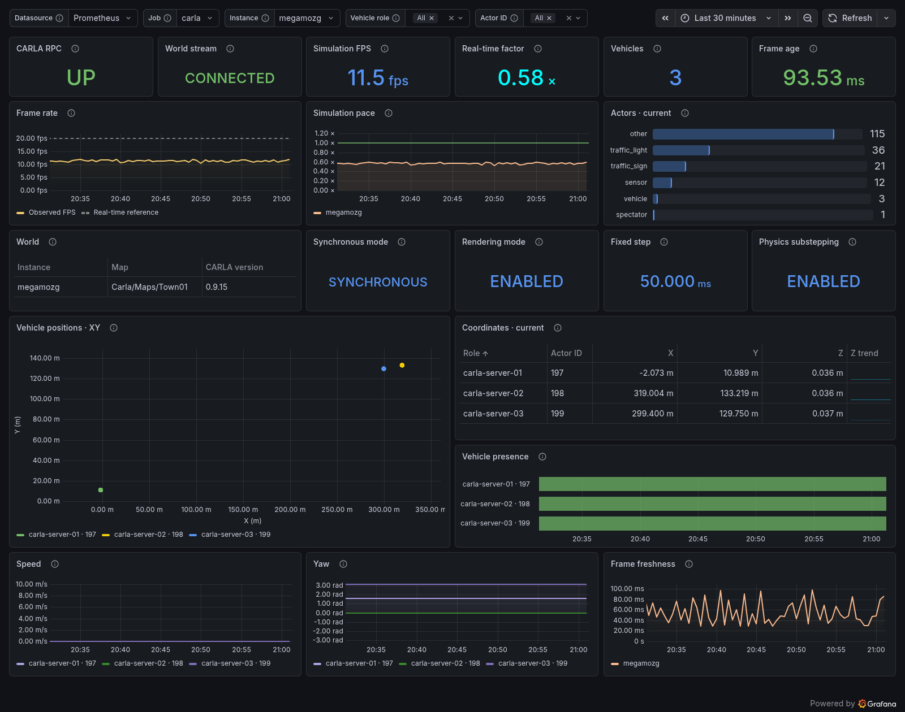

# CARLA Exporter

[](https://github.com/Adanomy/carla-exporter/actions/workflows/ci.yml)
[](go.mod)
[](https://carla.org/)
[](LICENSE)

A read-only Prometheus exporter for **CARLA**. Monitor simulation
performance, world state, and vehicle telemetry with a single Go binary.

Supports **0.9.12–0.9.16** and **0.10.0 (UE5)** with automatic protocol selection.

[](https://adanomy.com/)
[](https://github.com/Adanomy/carla-exporter/releases)
[](docs/metrics.md)
[](https://grafana.com/grafana/dashboards/25974)
[](#configuration)

[](docs/images/dashboard.png)

## Quick start

Start the exporter against an existing CARLA server. Replace `carla.example.com`
and the ports with endpoints reachable from the container:

```sh
docker run -d \
  --name carla-exporter \
  --restart unless-stopped \
  -p 9840:9840 \
  ghcr.io/adanomy/carla-exporter:latest \
  --carla.address=carla.example.com:2000 \
  --carla.stream-address=carla.example.com:2001
```

<details>
<summary>Docker Compose</summary>

For a persistent deployment, save this as `compose.yaml`:

```yaml
services:
  carla-exporter:
    image: ghcr.io/adanomy/carla-exporter:latest
    restart: unless-stopped
    ports:
      - "9840:9840"
    command:
      - --carla.address=carla.example.com:2000
      - --carla.stream-address=carla.example.com:2001
```

```sh
docker compose up -d
```

View logs with `docker compose logs -f carla-exporter`.

</details>

Metrics are served at [localhost:9840/metrics](http://localhost:9840/metrics).
Check exporter health at [/healthz](http://localhost:9840/healthz) and logs with
`docker logs -f carla-exporter`. The health endpoint checks the HTTP process;
CARLA RPC health is reported by `carla_rpc_up`, and the world stream connection
by `carla_world_stream_connected`.

The image supports **Linux amd64/arm64** and runs as a non-root user.
The `latest` tag follows the newest stable release; use a version tag such as
`v0.1.0` or an image digest to keep a deployment fixed.
Standalone binaries for Linux, macOS, and Windows are distributed through
[Releases](https://github.com/Adanomy/carla-exporter/releases), with `SHA256SUMS`
for download verification.

Protocol and integration tests cover every supported release; live validation
currently covers **0.9.15**.

## Configuration

Configure the exporter with command-line flags, placed **after the image name**
in `docker run`, or in the service's `command` list in Compose. All settings have
defaults; the exporter does not read configuration files or environment variables.

### Connection and performance

| Flag | Default | Description |
| --- | --- | --- |
| `--web.listen-address` | `:9840` | HTTP listen address inside the container. Keep the default when publishing port `9840`. |
| `--carla.address` | `localhost:2000` | CARLA RPC endpoint as `host:port`. |
| `--carla.stream-address` | From CARLA | Override the world stream `host:port`, for example when using NAT, containers, or SSH tunnels. |
| `--carla.timeout` | `5s` | Total RPC budget per metrics collection and per stream setup attempt. Must be greater than zero and at most `1m`. |
| `--performance.window` | `10s` | Rolling real-time window for FPS and real-time factor. Accepts `1s` to `15m`. |
| `--carla.reconnect-min` | `1s` | Initial delay before reconnecting the world stream. |
| `--carla.reconnect-max` | `30s` | Maximum base reconnect delay, before random jitter. Must be at least `reconnect-min` and at most `5m`. |
| `--carla.max-message-bytes` | `16777216` | Maximum size of an RPC response or stream frame, in bytes. Accepts `1024` to `67108864` (64 MiB). |

Both the RPC endpoint and the TCP world stream must be reachable. CARLA usually
uses ports `2000` and `2001`; without an override, the stream endpoint is taken
from CARLA's connection token. Inside a container, `localhost` refers to the
container itself. With Docker Desktop, use
[`host.docker.internal`](https://docs.docker.com/desktop/troubleshoot-and-support/faqs/general/#how-do-i-connect-from-a-container-to-a-service-on-the-host)
for CARLA running on the host.

FPS and real-time factor appear after a full performance window and warm up
again after reconnecting or changing worlds. Pauses count toward the real-time
window. The RPC timeout does not limit how long an established stream can wait
for a new frame in a paused simulation. Reconnect delays double up to the base
maximum, with up to 25% jitter added.

### Vehicle filters

By default, telemetry includes every vehicle with an available actor description.
Filters only affect per-vehicle metrics; world actor and vehicle counts are
computed before vehicle filtering. Actors omitted by CARLA's description lookup
are skipped for that scrape.

| Flag | Default | Description |
| --- | --- | --- |
| `--vehicle.actor-id` | All | Include an exact numeric actor ID. Repeat for multiple IDs. |
| `--vehicle.role-name` | All | Include an exact, case-sensitive CARLA role name. Repeat for multiple roles. |
| `--vehicle.blueprint` | All | Include matching blueprint IDs. Supports glob patterns such as `'vehicle.tesla.*'`; repeat for multiple patterns. |

Values within one filter are combined with **OR**; different filters are combined
with **AND**. For example, adding `--vehicle.role-name=hero
--vehicle.role-name=ego_vehicle --vehicle.blueprint='vehicle.tesla.*'` selects
Tesla vehicles whose role is either `hero` or `ego_vehicle`. Quote glob patterns
to prevent shell expansion.

### Logging and diagnostics

| Flag | Default | Description |
| --- | --- | --- |
| `--log.level` | `info` | Log verbosity: `debug`, `info`, `warn`, or `error`. |
| `--log.format` | `text` | Log output format: `text` or `json`. |

Logs are written to stderr. Add `--log.format=json` for structured logs or
`--log.level=debug` for troubleshooting. Print all options with
`docker run --rm ghcr.io/adanomy/carla-exporter:latest --help`; use `--version`
to print build information and exit.

## License

[MIT](LICENSE). [Contributing](CONTRIBUTING.md) · [Security](SECURITY.md)
